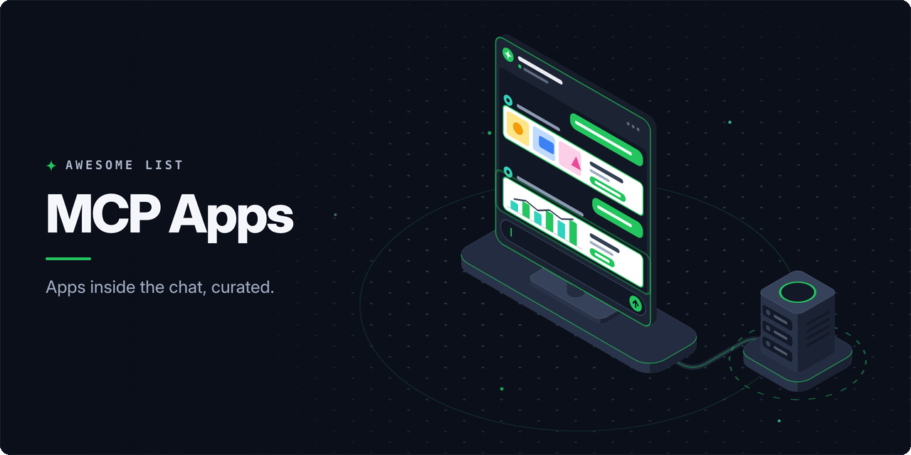

<!-- awesome:hero --><!-- /awesome:hero -->

<!-- awesome:title --><h1 align="center">Awesome MCP Apps</h1><!-- /awesome:title -->

<!-- awesome:tagline -->Interactive apps that run inside chat hosts: the MCP Apps extension, MCP-UI, the OpenAI Apps SDK, SDKs, examples and directories.<!-- /awesome:tagline -->

<!-- awesome:badges -->

  
  
  

<!-- /awesome:badges -->

An MCP App is an interactive view, such as a form, chart, map or editor, that an MCP server ships into a chat host like Claude, ChatGPT or VS Code. This list covers the standards behind them and the SDKs, UI kits, hosts, tools, examples, open-source apps and guides for building them.

## Contents

- [Specifications](#specifications)
- [SDKs and frameworks](#sdks-and-frameworks)
- [UI kits](#ui-kits)
- [Hosts](#hosts)
- [Developer tools](#developer-tools)
- [Templates and examples](#templates-and-examples)
  - [Templates](#templates)
  - [Examples](#examples)
- [Open-source apps](#open-source-apps)
- [Directories and lists](#directories-and-lists)
- [Guides](#guides)
- [Contributing](#contributing)

## Specifications

- [MCP Apps](https://github.com/modelcontextprotocol/ext-apps) - Official MCP extension and SDK for interactive UIs that servers render inside chat hosts.
- [MCP Apps overview](https://modelcontextprotocol.io/extensions/apps/overview) - Official docs on how a tool links to a UI resource and how a host renders it.
- [MCP Apps specification](https://github.com/modelcontextprotocol/ext-apps/blob/main/specification/2026-01-26/apps.mdx) - The 2026-01-26 version of the extension specification.
- [OpenAI Apps SDK](https://developers.openai.com/apps-sdk) - OpenAI's docs for building ChatGPT apps from an MCP server and a web component.
- [SEP-1865](https://github.com/modelcontextprotocol/modelcontextprotocol/pull/1865) - The merged proposal that added interactive user interfaces to MCP as MCP Apps.

## SDKs and frameworks

- [chapplin](https://github.com/ssssota/chapplin) - TypeScript framework for building MCP Apps and ChatGPT apps.
- [FastMCP](https://github.com/PrefectHQ/fastmcp) - Python MCP framework whose Apps feature renders tool UIs in the conversation.
- [FastMCP TypeScript](https://github.com/PrefectHQ/fastmcp-ts) - TypeScript FastMCP with a server-side component library for MCP Apps UIs.
- [Fractal SDK](https://github.com/fractal-mcp/sdk) - Toolkit for building widget apps for the OpenAI Apps SDK and MCP-UI.
- [Gadget](https://gadget.dev/build-chatgpt-apps) - Hosted app platform with a template for building and deploying ChatGPT apps.
- [MCP Apps Kit](https://github.com/AndurilCode/mcp-apps-kit) - TypeScript framework that targets MCP Apps and ChatGPT from one codebase.
- [MCP-UI](https://github.com/MCP-UI-Org/mcp-ui) - Client and server SDKs in TypeScript, Python and Ruby that implement MCP Apps.
- [mcp-use](https://github.com/mcp-use/mcp-use) - Full-stack MCP framework for building MCP Apps with React views for ChatGPT and Claude.
- [shinymcp](https://github.com/JamesHWade/shinymcp) - R package that converts Shiny apps into MCP Apps.
- [Skybridge](https://github.com/alpic-ai/skybridge) - Full-stack TypeScript and React framework for MCP Apps and ChatGPT apps.
- [sunpeak](https://github.com/Alignbase/sunpeak) - MCP App framework and testing tool for ChatGPT apps and Claude connectors.
- [vite-plugin-chatgpt-widgets](https://github.com/gadget-inc/vite-plugin-chatgpt-widgets) - Vite plugin that bundles widget code for ChatGPT apps.
- [xmcp](https://github.com/basementstudio/xmcp) - TypeScript MCP framework that ships React widgets as MCP Apps and ChatGPT UI.

## UI kits

- [Apps SDK UI](https://github.com/openai/apps-sdk-ui) - OpenAI's design system and Tailwind tokens for ChatGPT app interfaces.
- [ChatGPT Apps SDK UI extensions](https://github.com/AINativeKit/chatgpt-apps-sdk-ui) - Maps, albums, carousels and other components built on Apps SDK UI.
- [Manifest UI](https://github.com/mnfst/manifest-ui) - shadcn/ui component library for ChatGPT apps and MCP Apps.
- [MCP UI Components](https://github.com/themesberg/mcp-ui-components) - Flowbite components for MCP Apps in Claude, ChatGPT and Gemini, built on Skybridge.
- [mcpcn](https://github.com/shadcn-labs/mcpcn) - shadcn/ui-style components for building ChatGPT, Claude and MCP Apps.
- [Prefab](https://github.com/PrefectHQ/prefab) - Python UI framework built for MCP Apps, with charts, tables and dashboards.

## Hosts

- [ChatGPT](https://developers.openai.com/apps-sdk/mcp-apps-in-chatgpt/) - OpenAI's chat app, which renders MCP Apps and Apps SDK widgets inline.
- [Claude](https://claude.com/blog/interactive-tools-in-claude) - Anthropic's assistant, which runs interactive connectors built as MCP Apps.
- [CopilotKit](https://docs.copilotkit.ai/generative-ui/mcp-apps) - React agent UI framework that renders MCP Apps inside your own app.
- [fast-agent](https://github.com/evalstate/fast-agent) - Agent framework and CLI with support for MCP Apps and the OpenAI Apps SDK.
- [FinClip ChatKit](https://github.com/Geeksfino/finclip-chatkit) - Embeddable chat SDK that renders MCP-UI, MCP Apps, AG-UI and A2UI content.
- [goose](https://github.com/aaif-goose/goose) - Open-source desktop and CLI agent that renders MCP Apps in its chat.
- [LibreChat](https://github.com/LibreChat-AI/LibreChat) - Self-hosted multi-model chat app that renders MCP-UI resources from tools.
- [MCP-UI Chat](https://github.com/idosal/scira-mcp-ui-chat) - Chat app that renders MCP-UI tool results as interactive components.
- [Nanobot](https://github.com/obot-platform/nanobot) - MCP host for building agents and chatbots, with MCP-UI support.
- [NimbleBrain](https://github.com/NimbleBrainInc/nimblebrain) - Self-hosted platform that runs MCP Apps in a sidebar alongside agent tasks.
- [Postman](https://learning.postman.com/docs/postman-ai/mcp-requests/interact) - API client whose MCP requests preview and interact with MCP App interfaces.
- [VS Code](https://code.visualstudio.com/docs/copilot/customization/mcp-servers) - Editor whose Copilot chat renders MCP Apps inline when a server supports them.

## Developer tools

- [Alpic](https://alpic.ai) - Platform to build, deploy, monitor and distribute ChatGPT apps and MCP servers.
- [Alpic Playground](https://docs.alpic.ai/distribution/playground) - Hosted playground that renders MCP Apps and ChatGPT widgets against a real model.
- [Alpic plugin](https://github.com/alpic-ai/alpic-plugin) - Agent plugin that teaches coding agents to build with Alpic and Skybridge.
- [ChatGPT App Builder Skill](https://github.com/BayramAnnakov/chatgpt-app-skill) - Agent skill that walks a coding agent through designing and building a ChatGPT app.
- [Manufact](https://manufact.com) - mcp-use's cloud for deploying MCP apps and checking them against ChatGPT and Claude.
- [Manufact Inspector](https://manufact.com/inspector) - mcp-use's inspector for debugging MCP servers and their app views.
- [MCP Apps agent skills](https://github.com/modelcontextprotocol/ext-apps/tree/main/plugins/mcp-apps) - Official skills that scaffold MCP Apps, add UI to servers and migrate OpenAI apps.
- [MCPJam Inspector](https://github.com/MCPJam/inspector) - Local tool to chat with, inspect and debug MCP servers, MCP Apps and ChatGPT apps.
- [Yavio](https://github.com/teamyavio/yavio) - Open-source product analytics for MCP Apps and ChatGPT apps.

## Templates and examples

### Templates

- [Apps SDK Template](https://github.com/alpic-ai/apps-sdk-template) - Minimal TypeScript ChatGPT app built on Skybridge.
- [ChatGPT app with Next.js](https://vercel.com/templates/next.js/chatgpt-app-with-next-js) - Vercel template for shipping a ChatGPT app with Next.js and MCP.
- [MCP App Template](https://github.com/sebderhy/mcp-app-template) - ChatGPT app template laid out for coding agents to modify.
- [MCP App with Hono](https://github.com/yusukebe/mcp-app-with-hono) - MCP App built with Hono and deployed on Cloudflare Workers.
- [MCP Apps Next.js Starter](https://github.com/vercel-labs/mcp-apps-nextjs-starter) - Minimal Next.js starter that serves an MCP server and its widget page.
- [Pomerium MCP App Template](https://github.com/pomerium/mcp-app-typescript-template) - MCP App template with a Node.js server, React widgets and Pomerium access control.
- [Sample AgentCore MCP Apps](https://github.com/aws-samples/sample-agentcore-mcp-apps) - Deploys an MCP App server on Amazon Bedrock AgentCore Runtime for ChatGPT and Claude.

### Examples

- [Apps SDK examples](https://github.com/openai/openai-apps-sdk-examples) - OpenAI's example ChatGPT apps with MCP servers and widget code.
- [Autodesk APS MCP App](https://github.com/autodesk-platform-services/aps-mcp-app-example) - Example MCP server for Autodesk Platform Services with MCP Apps UI.
- [ChatGPT Task Manager](https://github.com/sholajegede/chatgpt-task-manager-app) - Task manager app for ChatGPT with interactive widgets, built on the Apps SDK.
- [CopilotKit Generative UI](https://github.com/CopilotKit/generative-ui) - Generative UI examples for AG-UI, A2UI and MCP Apps.
- [Elastic Dashboard Builder](https://github.com/elastic/example-mcp-dashbuilder) - MCP App that builds Elastic dashboards and renders them inline in the chat.
- [Elastic Observability MCP App](https://github.com/elastic/example-mcp-app-observability) - Interactive SRE workflows for Elastic Observability inside Claude and VS Code.
- [Elastic Security MCP App](https://github.com/elastic/example-mcp-app-security) - Reference MCP App with SOC dashboards for Elastic Security.
- [LastMile ChatGPT app examples](https://github.com/lastmile-ai/openai-apps-sdk) - Hosted example ChatGPT apps built with the Apps SDK and mcp-agent.
- [MCP App message bridge](https://github.com/wynsyl1014/mcp-app-message-bridge) - Reference design for routing outside messages into ChatGPT through an MCP App UI.
- [MCP Apps examples](https://github.com/modelcontextprotocol/ext-apps/tree/main/examples) - Official example servers: maps, PDFs, charts, 3D scenes and starters per framework.
- [MCP Apps Playground](https://github.com/digitarald/mcp-apps-playground) - Demo MCP server that shows off interactive UI from the MCP Apps extension.
- [MCP ext-apps sample](https://github.com/hemanth/mcp-ext-apps) - Sample app for the MCP Apps extension as proposed in SEP-1865.
- [Microsoft MCP interactive UI samples](https://github.com/microsoft/mcp-interactiveUI-samples) - Small pattern-focused MCP App UI samples from Microsoft.
- [Movie Context Provider](https://github.com/render-examples/movie-context-provider) - OpenAI Apps SDK demo app ready to deploy on Render.
- [Sales analytics MCP Apps](https://github.com/ashitaprasad/sample-mcp-apps-chatflow) - Sales analytics MCP App deployed on Amazon Bedrock AgentCore, from a how-to article.

## Open-source apps

- [Alpix](https://github.com/alpic-ai/alpix) - Shared canvas that ChatGPT and Claude draw on through an MCP App.
- [Audio File MCP App](https://github.com/counterpoint-studio/audio-file-mcp-app) - Plays and inspects local audio files in an MCP host.
- [Brick Builder](https://github.com/dend/brick-mcp-app) - Three.js MCP App for designing 3D brick builds inside Claude and VS Code.
- [Copilot Compass](https://github.com/samueltauil/copilot-compass) - MCP App with dashboards for GitHub Copilot usage metrics.
- [DOOM ChatGPT App](https://github.com/brunobuddy/doom-chatgpt-app) - Plays DOOM inside ChatGPT as an app.
- [draw.io MCP](https://github.com/jgraph/drawio-mcp) - Official draw.io server whose MCP App renders diagrams inline in chat.
- [Excalidraw MCP](https://github.com/excalidraw/excalidraw-mcp) - Official Excalidraw MCP App that draws and streams diagrams in the chat.
- [Figma Console MCP](https://github.com/southleft/figma-console-mcp) - Figma design system server with experimental MCP Apps views.
- [Gemini MCP](https://github.com/houtini-ai/gemini-mcp) - Gemini image, video and chat tools whose results open in an MCP App viewer.
- [GPT Thinking Block](https://github.com/sibylsea-hub/gpt-thinking-block-mcp) - Shows a model's intermediate thinking as a collapsible MCP Apps card.
- [Mapbox MCP Server](https://github.com/mapbox/mcp-server) - Mapbox tools that show results as live interactive maps in MCP Apps hosts.
- [MCP Dashboards](https://github.com/KyuRish/mcp-dashboards) - Turns data into interactive dashboards inside AI clients as MCP Apps.
- [MCP Music Studio](https://github.com/linxule/mcp-music-studio) - Music composition and live coding studio with sheet music rendered as an MCP App.
- [Mermaid MCP App](https://github.com/Avcharov/mermaid-mcp-app) - Renders Mermaid diagrams with live preview and editing inside the chat.
- [open-mcp-apps](https://github.com/2nd1st/open-mcp-apps) - Engine for persistent MCP Apps that the model builds once and the user reuses.
- [PDF Tools](https://github.com/Open-Document-Alliance/PDF-Tools) - Fill, sign, merge and split PDFs, with an MCP Apps viewer for review.
- [Reading Nest](https://github.com/yueyue95/ss-reading-nest-open) - Co-reading app for novels and manga built with the ChatGPT Apps SDK.
- [Remotion MCP App](https://github.com/mcp-use/remotion-mcp-app) - Builds Remotion video compositions with a live player inside the chat.
- [Scientific Figure Library](https://github.com/xuzhougeng/ScientificFigureLibrary) - Local-first MCP App for importing, reviewing and publishing scientific figures.
- [VOICEVOX MCP](https://github.com/kajidog/mcp-tts-voicevox) - VOICEVOX speech server with an MCP Apps audio player in the chat.
- [yacli](https://github.com/NextStat/yacli) - CLI, MCP server and MCP Apps for Yandex Mail, Calendar and Disk.

## Directories and lists

- [Awesome ChatGPT Apps](https://github.com/rdmgator12/awesome-chatgpt-apps) - Categorized directory of the apps in OpenAI's ChatGPT app directory.
- [Awesome Generative UI](https://github.com/narrowin/awesome-generative-ui) - List of resources for interfaces that AI models compose and render.
- [Awesome MCP Clients](https://github.com/punkpeye/awesome-mcp-clients) - List of applications that act as MCP clients.
- [ChatGPT apps](https://chatgpt.com/apps) - OpenAI's official directory of apps that run inside ChatGPT.
- [Claude connectors](https://claude.com/connectors) - Anthropic's directory of Claude connectors, including interactive MCP Apps.

## Guides

- [Basically, MCP Apps](https://github.com/TejasQ/basically-mcp-apps) - Plain-language explainer of MCP Apps with a working example.
- [Build your first MCP App (Claude)](https://claude.com/docs/connectors/building/mcp-apps/getting-started) - Anthropic's guide to building an MCP App that runs in Claude.
- [Building MCP Apps with goose](https://goose-docs.ai/docs/tutorials/building-mcp-apps/) - goose tutorial on building an MCP App and running it in the goose chat.
- [ChatGPT app submission guidelines](https://developers.openai.com/apps-sdk/app-submission-guidelines) - OpenAI's rules an app must meet to be listed in the ChatGPT directory.
- [ChatGPT UI guidelines](https://developers.openai.com/apps-sdk/concepts/ui-guidelines) - OpenAI's design rules for app components shown inside ChatGPT.
- [Epic Web MCP UI workshop](https://github.com/epicweb-dev/mcp-ui) - Hands-on workshop on returning interactive UI from MCP tools.
- [How to build an MCP App (xmcp)](https://xmcp.dev/blog/mcp-apps) - xmcp walkthrough for shipping React widgets as MCP Apps.
- [Introducing apps in ChatGPT](https://openai.com/index/introducing-apps-in-chatgpt/) - OpenAI's announcement of apps in ChatGPT and the Apps SDK.
- [MCP Apps announcement](https://blog.modelcontextprotocol.io/posts/2026-01-26-mcp-apps/) - MCP blog post that launched MCP Apps as the first official MCP extension.
- [MCP Apps proposal](https://blog.modelcontextprotocol.io/posts/2025-11-21-mcp-apps/) - MCP blog post that proposed the extension, building on MCP-UI and the Apps SDK.
- [MCP Apps quickstart](https://apps.extensions.modelcontextprotocol.io/api/documents/quickstart.html) - Official quickstart for building an MCP App with the ext-apps SDK.
- [MCP Apps support in VS Code](https://code.visualstudio.com/blogs/2026/01/26/mcp-apps-support) - VS Code team post on rendering MCP Apps in Copilot chat.
- [MCP UI: Breaking the text wall](https://shopify.engineering/mcp-ui-breaking-the-text-wall) - Shopify engineering post on interactive commerce components over MCP.
- [MCP-UI docs](https://mcpui.dev/guide/introduction) - Guides for the MCP-UI SDKs on the server and the client side.
- [MCPJam MCP Apps example](https://www.mcpjam.com/blog/mcp-apps-example) - Walkthrough of building a first MCP App and testing it in MCPJam.
- [OpenAI Apps SDK quickstart](https://developers.openai.com/apps-sdk/quickstart) - OpenAI's step-by-step guide to a first ChatGPT app.
- [Running Next.js inside ChatGPT](https://vercel.com/blog/running-next-js-inside-chatgpt-a-deep-dive-into-native-app-integration) - Vercel's deep dive on serving a Next.js app as a ChatGPT app.

## Contributing

Contributions are welcome. Read the [contribution guidelines](contributing.md) first.

<!-- awesome:maintainer -->
Maintained by [Ian Wiedenman](https://github.com/ianwieds).
<!-- /awesome:maintainer -->
